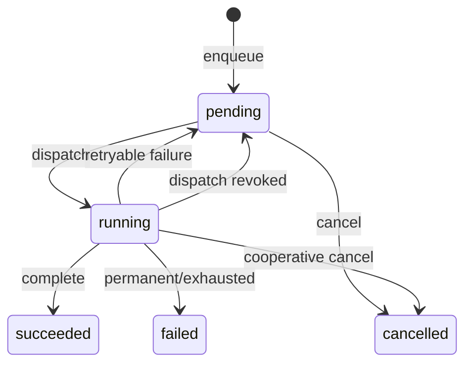

# 中央任务调度、任务队列与并发设计

> 状态：Accepted
> 版本：2.0.0
> 日期：2026-11-05
> 实施：中央任务服务、任务存储合并和维护联动已实现；真实数据迁移按整体三阶段计划另行执行。见 [ADR-0062](../adr/0062-central-task-scheduler.md)。

## 1. 运行模型

每个规范化本地数据目录只运行一个中央任务服务，与 CLI/Web 生命周期独立。CLI 和 Web 使用 common 的统一任务应用端口提交、查询、取消、重试及等待，并由 TaskClient 确认中央服务可用，不维护自己的调度与领取循环。持久化入队可参与业务短事务；IPC 同时提供简单任务命令，但不跨进程拆开业务记录与任务发布的原子提交。中央调度者管理多个执行进程，执行进程只接受分派。

common 提供客户端、服务发现、启动协调、本机 IPC、调度、执行进程管理和提交门控端口；业务模块提供处理器与周期配置查询契约。apps 组合根显式注入实现，通过内部启动模式运行服务和执行宿主，不增加 apps/worker 包或公开 worker 命令，common 不导入业务实现。

客户端首次连接时竞争跨进程启动锁，持锁后重新探测再启动。服务全生命周期保持排他所有权；PID 文件或心跳超时不能单独证明旧服务已退出。Unix socket、Windows named pipe 和锁通过平台适配器实现，IPC 限制为本机用户访问并校验消息。协议或配置不兼容时返回明确诊断，不另启第二套服务。

CLI 退出、停止等待或 Web 重启只关闭自身连接，不终止后台任务。显式服务关闭才停止分派、通知执行进程、等待安全点并释放资源。迁移、恢复和维护须协调中央服务及执行进程，禁止旧进程继续写入。

`resume.export.pdf@v1` 是 Worker 独占的本地浏览器任务。Web 先把已转义、无外部依赖的 HTML 快照写入临时文件，Worker 再用 Playwright 以 A4 和 `printBackground` 生成 PDF；任务按导出请求 ID 幂等，Web 进程不得直接启动 Chromium。

## 2. 任务状态机

招聘平台新增连接、单批浏览和详情短任务，见 [平台架构](./recruitment-platforms.md) 与 [028 设计](../../specs/028-recruitment-platforms/design.md)。会话型任务固定路由到持有对应会话的执行进程；Cookie 与私有游标只留内存，持久任务仅含非敏感 ID。连接代次、查询版本和取消状态在写入前核验；同浏览会话串行推进，每次用户请求最多一批，不后台遍历。重启后要求重新连接或重新开始浏览，不将内存凭据写进持久队列以便恢复。

平台正常职位保留清理复用现有 Worker 运维任务与 SQLite 维护保护；自动删除须显式启用，执行前重检业务引用。平台按需任务不启动官网缺失下架流程。



状态转换必须通过 Repository 方法完成，调用方不能直接拼接状态更新。

## 3. 中央分派与提交门控

中央调度者在短事务内选择到期 pending 任务、设置 running、生成唯一分派凭证并递增累计尝试次数；网络与模型调用在事务外进行。执行进程报告心跳和检查点，由中央调度者判断超时、撤销旧凭证、通知取消，再按预算重新分派。

业务仓储必须在结果提交事务内验证当前任务、服务代次、分派凭证、running 与取消状态，不能先在内存检查再另开事务写入，也不能只保护 tasks 更新。业务结果和检查点可在同一 SQLite 事务提交时必须原子提交。撤销先发生则拒绝旧结果；结果提交先发生则后续取消不得把已发布结果伪装成 cancelled。

调度者重启取得排他所有权后撤销旧分派，从已提交检查点恢复。执行进程控制连接断开后停止工作；迟到返回仍须被门控拒绝。业务幂等防止重复事实，分派校验防止旧执行者覆盖结果，外部请求不承诺恰好一次。

执行权持久化的精确列结构在实现协议时确定，不能先删除现有租约保护。SQLite 承担状态持久化与原子条件更新，调度和超时判断由系统逻辑负责。

按类型维护逻辑队列和可配置槽位，未配置类型并发默认为 1；慢类型不得阻塞其他类型。中央服务统一发放跨进程网络许可并维护来源 Token Bucket，来源节流等待不占网络许可，取消后移除排队项。全局上限不能随执行进程数量放大。空队列和数据库锁忙使用异步退避，不能伪报心跳或提交成功。

## 4. 幂等与重试

按 ADR-0045，手动重试不创建任务：仓储在同一事务写入 `task_retry_logs` 的脱敏失败诊断及操作令牌，再将原任务置为 pending。保留 ID、业务关联、原始创建时间与幂等键，保留累计尝试次数，扩展上限为累计次数加 Handler 本轮预算，并撤销旧分派；历史子任务链继续可查。重复操作令牌不触发新一轮执行，并发键仍与正常入队一致。

`idempotency_key` 防止同一逻辑输入重复入队；`concurrency_key` 防止不同输入但互斥的活动任务并存。数据库对非空 concurrency key 在 `pending/running` 状态建立部分唯一索引，应用层将冲突映射为“已有活动任务”。来源同步固定使用 `source-sync:{sourceId}`，不能只依赖先查后写。

任务幂等键由任务类型和不可变输入版本生成，例如：

```text
source.sync:{sourceId}:{requestedWindowOrManualToken}
job.enrich:{jobRevisionId}:{agentVersion}:{promptVersion}:{modelConfigHash}
match.compute:{profileVersionId}:{jobRevisionId}:{jobEnrichmentIdOrNone}:{rulesetVersion}
```

任务处理器必须先检查目标结果是否已经存在。即使任务因超时接管而重复执行，也不能重复发布事实或覆盖更新的业务输入。

重试策略：

| 错误类别            | 默认策略                          |
| ------------------- | --------------------------------- |
| `rate_limited`      | 尊重 `Retry-After`，否则指数退避  |
| `network_temporary` | 指数退避 + 抖动，最多 5 次        |
| `upstream_5xx`      | 指数退避 + 抖动，最多 5 次        |
| `parse_changed`     | 不自动密集重试，来源标记 degraded |
| `invalid_config`    | 直接失败，等待配置修复            |
| `validation_failed` | 直接失败并保存脱敏样本引用        |
| `cancelled`         | 不重试，除非用户重新发起          |

退避上限默认 6 小时。错误摘要不得包含响应中的个人信息、Cookie、Token 或完整简历。

## 5. 调度语义

- 已移除 schedules 专表与 tasks.schedule_id；周期配置由来源、邮箱及系统设置的所有者提供，Cron 按其时区解释，默认 Asia/Shanghai。
- 中央专用周期循环每次推进一个 occurrence，按配置身份和 occurrence UTC 时间生成幂等键，每次运行创建独立任务；不能只靠内存队列去重。
- 中央服务停机期间错过多个周期时，默认只补最近一次，不进行无界追赶。
- 同一来源已有 `pending` 或 `running` 同步任务时，`source-sync:{sourceId}` 并发键使新周期返回已有活动任务。
- 手动同步可以使用独立幂等 token，但仍使用同一来源并发键，不允许与计划同步并行。

## 6. 关闭与恢复

中央服务收到关闭请求后（客户端退出不触发）：

1. 立即停止调度和领取新任务。
2. 触发在途 Handler 的 `AbortSignal`。
3. 在配置的宽限期内等待安全点。
4. 已产生外部请求但尚未写入的结果可以丢弃并重试。
5. 正在短事务中的写操作完成或回滚。
6. 持久化未完成状态，撤销旧分派；新服务取得排他所有权后从检查点恢复。

不得通过强行把所有在途任务改回 `pending` 来关闭，因为无法确定外部操作是否已完成。业务幂等、分派门控和持久检查点共同处理不确定结果。

## 7. 可观测性与测试

每次任务执行记录 `taskId`、`taskType`、`attempt`、`dispatchId`、耗时和结果。队列必须可查询：待处理数、最老等待时长、运行数、失败数和分派超时数。

开发前必须具备以下测试设计：

- CLI/Web 同时冷启动只创建一个中央服务，不同数据目录相互隔离；同一任务只有一个有效分派。
- 执行进程或调度者退出后任务可恢复，旧分派不能更新任务、检查点或业务结果。
- 同一任务重复执行不产生重复领域结果。
- 不可重试错误不会进入循环。
- 调度器重启不会重复创建同一 occurrence。
- 取消信号能传递到网络和模型调用。
- running 取消默认优先于完成；只有最终业务事务已按 Task ID、服务代次、分派凭证、running 与未取消条件门控的 Handler 才允许“提交先发生”时由完成获胜，避免业务结果已可见但 Task 状态为 cancelled。
- 不同幂等键但相同并发键的任务不能同时处于 pending/running。

任务诊断使用 tasks 上的批次与重试根派生字段，由数据库迁移回填、插入触发器维护；
执行输入与重试关联不因重试改变，private_state 中的恢复检查点按提交门控更新。普通任务及来源运行详情通过诊断仓储批量投影，
不暴露 payload。详见 [ADR-0019](../adr/0019-task-diagnostic-projection.md)。

中央调度服务驱动 SQLite 维护子进程；数据库维护标记与连接级写保护协调入口和所有执行进程的短暂写入窗口。
详见 [ADR-0020](../adr/0020-sqlite-automatic-maintenance.md)，应用端口仍由数据库基础设施实现。

## 目标存储与验收边界

目标 tasks 使用 type/status、public_state/private_state 及必要索引列。public_state 仅保存白名单阶段、进度、脱敏结果与错误；private_state 按类型校验输入引用、检查点及内部上下文，不返回客户端，大型正文仍存业务表或文件。身份、时间、幂等键、并发键和调度查询字段使用独立列；分派字段随恢复协议确定。correlation_id 仅用于追踪，不替代幂等键，不添加无明确用途的 recovery_key。

sync_runs 合并至 tasks，保留覆盖判断、统计、阶段和扫描身份。从头重扫更换扫描身份，评分重试复用已完成采集；不完整采集不得触发职位缺失关闭。version/hash/cursor 不机械搬入 JSON，只保留有消费方且不可可靠重建的数据。详情批次诊断保留可索引投影与单次聚合分页。

分阶段任务持久化检查点；面经研究生成及导入完成后，人工审核由业务状态承接，不长期占执行槽位。具体业务表迁移另行设计。

实现验收还须覆盖 CLI 退出与 Web 重启不影响任务、跨进程网络上限、取消与提交的两种顺序、配置不兼容、维护协调、定时重启不重复触发、夏令时与错过周期补执行。本文不代表现有数据库或实现已改变。
