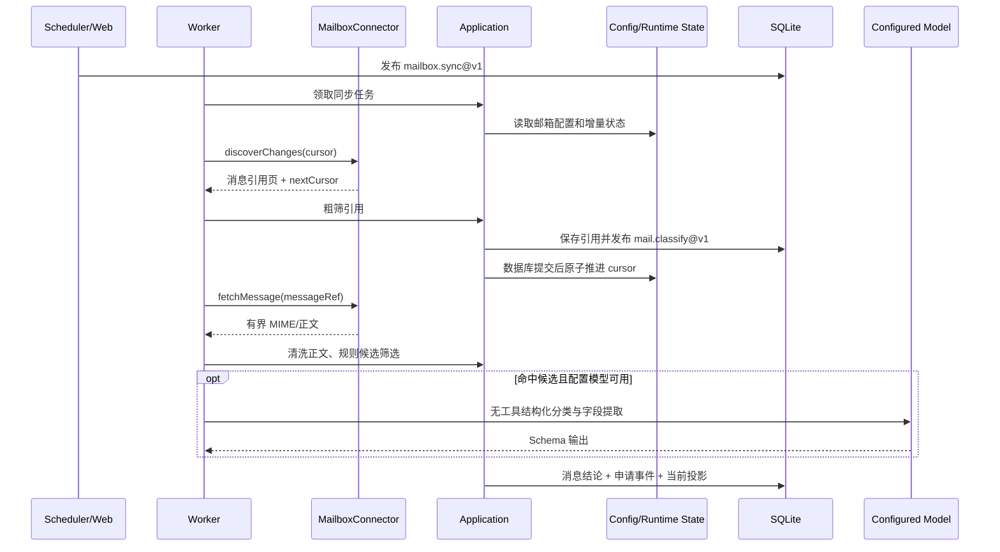

# 029 招聘邮件识别与申请进展跟踪设计

> 状态：Ready
> 对应规格：[spec.md](./spec.md)
> 架构决策：[ADR-0055](../../docs/adr/0055-recruitment-mail-ingestion-and-privacy-boundary.md)、[ADR-0056](../../docs/adr/0056-encrypted-mail-credential-file.md)

## 1. 设计结论

招聘邮件不是职位来源的另一种传输形式。它承载用户私有的申请流程事件，不具备官网同步的覆盖、缺失和职位关闭语义，因此建立独立的招聘进展领域和邮箱连接器边界：

1. 邮箱协议位于 `packages/mail/core`，具体提供商实现位于 `packages/mail/connectors`。
2. Web 或 CLI 只发起授权、设置、查询和任务发布；邮件增量读取、正文获取和分类由 Worker 执行。
3. 先用版本化确定性规则筛选招聘流程候选，稳定负例不调用模型；候选邮件由用户配置的无工具 Agent 理解正文并提取字段。
4. 不归档完整邮箱。无关邮件和待确认邮件只保存最小消息引用与处理状态；已接受邮件保存申请事件，不保存独立分类版本或中间分类结果。
5. `JobApplication` 与 `ApplicationEvent` 拥有独立生命周期，可选择性引用正式 `Job`，但不修改职位事实或职位状态。
6. 邮箱设置保存在本地非敏感配置，增量游标和健康状态保存在数据目录运行状态文件；SQLite 不保存邮箱连接或游标。配置文件默认位于 `<dataRoot>/mail/mailboxes.json`，可由工作区 `.env` 中的 `JOBHUNTER_MAILBOX_CONFIG_PATH` 指定绝对或相对工作区路径。
7. 首版采用本地增量轮询，不建设需要公网回调的推送基础设施，也不提供分类字段或既有事件的人工更正。
8. 首版同时交付 `gmail`、`microsoft-graph` 和 `imap` 三个连接器；每个连接器独立经过授权、首次回溯、增量、游标恢复、断开和重新授权门禁，三者全部 supported 后才算 M1 完整交付。

## 2. 包与依赖边界

邮箱能力使用两个嵌套 workspace 包，而不是在 `packages/` 根目录继续增加平铺的 `mail-core` 与 `mail-connectors`：

```text
packages/mail/
├─ core/                    # @jobhunter/mail-core
│  ├─ src/
│  ├─ test/
│  ├─ package.json
│  └─ tsconfig.json
└─ connectors/              # @jobhunter/mail-connectors
   ├─ src/
   ├─ test/
   ├─ package.json
   └─ tsconfig.json
```

实现时在 `pnpm-workspace.yaml` 增加 `packages/mail/*`，并同步扩展 dependency-cruiser 的公开入口与依赖规则。

```text
apps/web ─────────────┐
apps/worker ──────────┼─→ application ─→ domain
apps/cli ─────────────┘        │
                              ├─→ mail/core ←─ mail/connectors
                              └─→ agent-core

apps/* ─────────────────────────────→ mail/connectors
db ─────────────────────────────────→ application/domain
```

约束如下：

- `mail/core` 只声明连接器元数据、授权与读取协议、外部邮件 DTO、错误类别和契约测试，不依赖任何业务包或具体 SDK。
- `mail/connectors` 只依赖 `mail/core` 及具体提供商或协议库，实现授权、增量读取和凭据解析。
- `application` 可以依赖 `mail/core`，但不得导入 `mail/connectors`；邮箱配置、运行状态、Repository、删除和事务端口仍由应用层声明。
- `domain` 新增申请事件、申请状态及状态投影规则，不感知邮箱协议、凭据、数据库、任务或模型。
- `apps/*` 负责装配连接器、凭据库、应用服务和 Worker Handler；邮件正文读取只在 Worker Handler 内发生。

## 3. 连接器契约

### 3.1 能力元数据

每个连接器声明：

```ts
interface MailConnectorMetadata {
  readonly providerKey: string;
  readonly version: string;
  readonly authKind: 'oauth' | 'app_password';
  readonly incrementalMode: 'history' | 'delta' | 'imap_uid';
  readonly folderMode: 'labels' | 'folders';
  readonly supportsStableMessageId: boolean;
  readonly supportStatus: 'experimental' | 'supported' | 'blocked';
}
```

`providerKey` 是可扩展注册键；封闭能力值在 `mail/core` 使用运行时 Schema 校验。支持状态与连接健康分开，外部服务暂时失败不能把实现能力降为 blocked。

### 3.2 授权端口

授权协议提供开始授权、完成授权、探测身份和撤销授权能力。应用层只接收写入本地非敏感配置所需的结果：

```ts
interface MailboxAuthorizationResult {
  readonly credentialRef: string;
  readonly externalAccountKeyHash: string;
  readonly maskedAddress: string;
  readonly grantedCapabilities: readonly string[];
}
```

Token、刷新令牌和应用专用密码由连接器侧的 `CredentialVault` 使用 AES-256-GCM 写入独立加密文件，不能作为普通应用服务返回值、Task payload 或 Repository 参数。每条记录使用独立随机 IV，并将版本和 `credentialRef` 作为 AAD；密钥来自独立密钥文件或 `JOBHUNTER_MAILBOX_CREDENTIAL_KEY`。设置页允许用户主动点击按钮，通过无缓存的受控接口临时读取 IMAP `password` 并以密码模式展示；OAuth access/refresh token 永不回传。OAuth 回调代码只允许在本机授权流程中瞬时存在，交换完成后立即丢弃且不得记录。

默认路径为 `<dataRoot>/mail/credentials.enc.json` 和 `<dataRoot>/mail/credentials.key`，可分别由 `JOBHUNTER_MAILBOX_CREDENTIAL_PATH`、`JOBHUNTER_MAILBOX_CREDENTIAL_KEY_PATH` 覆盖。Windows Credential Manager 仅作为旧版本一次性迁移来源：按已有配置引用读取，写入新文件并解密校验后撤销旧副本；运行时不再依赖平台专有凭据库。首版由 Web 独占凭据写操作，Worker 接入时只读；未来若 Worker 需要刷新令牌回写，必须先增加跨进程写协调。

### 3.3 读取端口

读取协议分为轻量发现和按需正文两个阶段：

```ts
interface MailboxConnector {
  readonly metadata: MailConnectorMetadata;

  listFolders(context: MailboxReadContext): Promise<readonly MailFolder[]>;

  discoverChanges(
    context: MailboxReadContext,
    request: MailChangeRequest,
  ): AsyncIterable<MailChangePage>;

  fetchMessage(
    context: MailboxReadContext,
    message: ExternalMailMessageRef,
  ): Promise<ExternalMailMessage>;

  healthCheck(context: MailboxReadContext): Promise<MailHealthResult>;
}
```

`discoverChanges` 只返回稳定消息键、线程键、接收时间、内容版本、可选来源邮件 URL、可用头部摘要和下一游标；`fetchMessage` 才读取受大小限制的主题、发件信息与正文，所有附件均不读取。所有方法接受 `AbortSignal`、超时和连接级限流上下文。

提供商原生 ID 不稳定时，连接器负责生成可重放键。例如 IMAP 使用文件夹身份、`UIDVALIDITY` 和 UID 组合，不把不稳定序号直接暴露为长期身份。来源邮件 URL 只允许经过 Schema 校验、不含授权凭据或一次性访问令牌的 `https` 地址，并且可以为空；IMAP 等没有安全网页入口的协议仍以稳定消息键完成去重和重取。游标视为不透明数据，只能由同 provider、连接代次和连接器版本继续解释。

### 3.4 首批连接器方案

三个连接器共享 `mail/core` 契约，但分别保留提供商原生的授权、增量和恢复语义，不在应用层伪造统一游标格式：

| provider key      | 授权与最小权限                          | 首次有界回溯                                              | 后续增量                                    | 稳定消息身份                             | 来源 URL                     |
| ----------------- | --------------------------------------- | --------------------------------------------------------- | ------------------------------------------- | ---------------------------------------- | ---------------------------- |
| `gmail`           | OAuth 2.0；只申请 `gmail.readonly`      | 按用户选择的标签执行有界 `messages.list`，再补齐并发变化  | `users.history.list` + `historyId`          | Gmail message ID                         | 仅能安全生成并通过校验时保存 |
| `microsoft-graph` | OAuth 2.0 delegated；只申请 `Mail.Read` | 对每个用户选择的邮件文件夹完成有界 message delta 初始轮次 | 文件夹级 `@odata.nextLink/deltaLink`        | `Prefer: IdType="ImmutableId"` 返回的 ID | 校验后保存 message `webLink` |
| `imap`            | 用户名与应用专用密码；强制 TLS          | 只读选择文件夹并按日期和 UID 执行有界扫描                 | `UIDVALIDITY + UID`；优先 CONDSTORE/QRESYNC | 文件夹身份 + `UIDVALIDITY` + UID         | 默认不提供，保持 `null`      |

#### 3.4.1 Gmail API

- 授权使用本机 OAuth 2.0 流程，凭据直接进入 `CredentialVault`。`gmail.readonly` 已足够读取消息、线程和标签，不申请修改、发送或删除权限；设置页必须提示该 restricted scope 的 Google 验证与安全要求可能影响分发方式。
- 默认标签为 `INBOX`。首次同步先读取当前 profile 的 `historyId` 作为并发变化起点，再使用 `messages.list` 的标签和日期条件枚举回溯窗口内消息，逐页提交后从该起点执行 `users.history.list` 追平同步期间发生的变化，最后保存最新 `historyId`。
- 后续同步把 `startHistoryId` 作为不透明游标分页读取 history。连接器把新增消息、消息内容或标签变化归一化为消息引用变化；重复 history 记录依赖 `(mailboxKey, externalMessageKey)` 和内容版本消重。
- 当 Gmail 明确拒绝过旧或无效的 `startHistoryId` 时，映射为 `cursor_invalid`，从最近成功时间减安全窗口执行不超过 365 天的有界重建，不退化为无界全邮箱扫描。
- `externalMessageKey` 使用 Gmail message ID，`contentVersion` 使用能够反映该消息最近变化的 history 标识。Gmail 没有 API 返回的稳定 `webLink`；只有在账号上下文明确且能生成不含凭据或一次性令牌的网页地址时才保存 `sourceUrl`，否则留空。

#### 3.4.2 Microsoft Graph

- 授权使用本机 OAuth 2.0 delegated 流程，只申请 `Mail.Read`；`Mail.ReadBasic` 不足以按需读取招聘邮件正文。首版不申请 application permission，也不申请 `Mail.ReadWrite` 或发送权限。
- 每个用户选择的 mailFolder 独立维护 delta 状态。首次同步对该文件夹发起有界 message delta 初始轮次，只选择发现阶段所需字段并消费全部 `@odata.nextLink`；完成后保存最终 `@odata.deltaLink`。后续请求直接使用已保存链接，应用层不得拆解或拼接其中的状态令牌。
- 初始请求、分页链接、delta 链接和按需消息读取都发送 `Prefer: IdType="ImmutableId"`，使移动到同一邮箱其他文件夹时消息 ID 保持稳定。连接器仍需把文件夹级删除、新增或移动变化归一化，并由消息唯一键消重。
- `externalMessageKey` 使用 immutable ID，`contentVersion` 优先使用 `changeKey`，否则使用经过契约校验的提供商变化版本。message `webLink` 只有通过 `https`、主机和敏感查询参数校验后才保存为 `sourceUrl`。
- 当 Graph 声明 delta 状态不可继续使用时，映射为 `cursor_invalid`，只重建受影响文件夹的有界窗口；其他文件夹和邮箱继续同步。

#### 3.4.3 通用 IMAP over TLS

- 首版支持 QQ、163 和允许第三方客户端访问的企业邮箱，使用用户显式提供的服务器、端口、用户名和应用专用密码。连接必须使用 IMAPS 或先成功完成 STARTTLS，并严格校验证书；不允许明文认证或降级到非 TLS。
- 会话通过 `EXAMINE` 只读打开用户选择的文件夹。发现阶段优先只取 UID、内部日期、大小和必要头部；正文阶段使用 `UID FETCH` 与 `BODY.PEEK`，不得设置 `\\Seen` 或修改任何旗标。
- 每个文件夹保存 `UIDVALIDITY`、最近已提交 UID，以及服务器支持时的 `HIGHESTMODSEQ`。支持 CONDSTORE/QRESYNC 时用其发现变化和 expunge；否则按 UID 范围增量扫描，并把重复消息交给稳定身份约束消重。
- `externalMessageKey` 必须包含规范化文件夹身份、`UIDVALIDITY` 和 UID；`contentVersion` 可组合 UID、mod-sequence 和连接器解析版本。`UIDVALIDITY` 改变时映射为 `cursor_invalid`，仅对该文件夹执行有界重建。
- IMAP 协议没有通用、安全且稳定的网页消息入口，因此 `sourceUrl` 默认留空；厂商专有网页地址不在通用 IMAP 连接器中猜测生成。

### 3.5 错误分类

连接器错误统一映射为：

- `authentication_required`
- `permission_denied`
- `rate_limited`
- `network_temporary`
- `upstream_5xx`
- `cursor_invalid`
- `message_not_found`
- `parse_changed`
- `invalid_config`
- `payload_too_large`
- `cancelled`

认证和权限错误暂停自动同步并提示重新授权；游标失效触发有界重建；单邮件不存在只结束该邮件处理，不回滚已经提交的同批结果。

## 4. 运行流程与任务



### 4.1 `mailbox.sync@v1`

- payload：`mailboxKey`、触发方式和可选手动操作令牌，不包含文件夹游标或任何邮件内容。
- 并发键：`mailbox-sync:{mailboxKey}`。
- 计划默认按本地时区每 10 分钟执行，可由设置关闭或调整；停机期间只补最近一次 occurrence。
- 每个增量页先在事务外获取并校验，再在一个短事务内保存新引用并发布对应分类任务；数据库提交后，才以临时文件加原子替换更新 `<dataRoot>/mail/runtime-state.json` 中的页游标。若数据库提交后、游标写入前崩溃，下次允许整页重放，并由消息唯一键和任务幂等键消重。
- 初次同步使用 90 天回溯；游标失效时从最近成功时间向前留出安全窗口，但总范围仍受 365 天上限约束。

### 4.2 `mail.classify@v1`

- payload：`mailMessageRefId`、预期 `contentVersion` 和分类策略版本，不包含主题、地址或正文。
- 任务幂等键：`mail-classify:{messageRefId}:{contentVersion}:{policyVersion}`；正文读取后再以 `messageRefId + contentHash + sourceEventNo` 约束最终申请事件，分类器版本仅用于追溯，不能绕过业务唯一约束。这样可避免提供商版本变化或分类策略重跑时产生重复事实。
- 并发度独立配置并共享 Worker 全局网络信号量；同一消息的内容版本变更可以产生新任务。
- Handler 在事务外获取正文、解析 MIME、清洗引用历史、执行规则或 Agent；最终输出全部校验后才进入短事务。
- 最终事务更新消息处理结论、追加申请事件并更新申请当前投影，通过 Task 状态门控处理取消与租约竞争。自动接受结果直接提交事件；待确认只更新 `mail_message_refs.processing_status`。用户打开详情时重新读取和分类原邮件，确认时提交刚通过校验的结果。

### 4.3 `mail.retention@v1`

- 定期清理超过保留窗口的无关邮件引用和已失效失败诊断。
- 删除招聘派生数据必须由用户显式发起，不能由普通保留任务删除仍被申请时间线引用的消息引用或事件。

## 5. MIME 清洗与候选粗筛

处理顺序固定如下：

1. 校验消息总体大小、multipart 深度、头部数量和允许的内容类型。
2. 优先读取有信息量的 `text/plain`；缺少可信纯文本时把 HTML 静态清洗为文本。对于 Moka 等富文本模板，允许从明确的 `data-text` 正文节点恢复文本，但仍不得执行脚本、加载资源或读取附件。
3. 删除脚本、样式、不可见内容、远程资源、跟踪像素和表单控件，不解析页面执行结果。
4. 识别签名、免责声明和引用历史边界；正文和引用历史分别保留有界片段，避免旧线程拒信覆盖当前邀请。
5. 日历和其他附件均不读取、不解析，也不发送给模型；正文声称关键信息仅存在于附件时，结果标记为信息不足。
6. 使用主题词、发件域、已知模板签名和正文短语执行高召回候选筛选。

粗筛只决定“是否需要进一步分类”，不能直接把模糊候选判为无关。职位推荐、营销和验证码等稳定负例可以由规则直接忽略；新的未知模式默认进入待确认。

## 6. 候选筛选、分类与字段提取

### 6.1 确定性候选筛选

规则由版本化策略组成，只判断邮件是否值得交给 Agent，不负责最终字段提取：

- 中英文主题和正文短语。
- 已知招聘系统发件域及模板结构。
- 申请编号、岗位名称和公司签名模式。
- 稳定负例，包括宣讲营销、邀请投递类岗位推广、满意度问卷、笔试或面试体验调查、验证码和普通招聘资讯。
- 否定、取消、改期、拒绝和 Offer 等强流程信号，以及引用历史边界。

规则输出候选与否、命中的规则 ID 和安全原因码。模板规则不能只依赖发件域：同一域可能同时发送营销、验证码和真实流程通知。规则没有把握时必须保守放行，避免未知模板被静默丢弃。

### 6.2 Agent 最终理解与提取

Agent key 初始版本为 `recruitment-mail.classify@v1`；030 日程规格将其输出契约升级为 `recruitment-mail.classify@v2`，工具集仍为空。所有通过规则筛选的候选邮件在配置模型可用时均由 Agent 完成最终语义分类与字段提取。输入仅包含：

- 清洗后的主题、发件显示名与域名。
- 有界当前正文；引用历史只在当前语义不足时保留有界片段。
- 确定性候选规则 ID 和原因码。
- 用户默认时区，不包含邮箱凭据或其他邮件。
- 不包含普通附件或附件提取文本。

输出必须符合与 `MAIL-008`、`MAIL-009` 对应的 Zod Schema。模型输出还需通过业务校验：

- `not_recruiting` 不能生成申请状态变化。
- `offer_intent` 不能输出 `offered` 状态。
- 时间必须保留原始文本和时区来源。
- URL 只允许 `https`，但不得由 Worker 打开或验证页面内容。
- 证据只能来自本次输入的短片段，不能生成输入中不存在的事实。

邮件分类 Agent 不启用持久化输出缓存；每次模型调用使用独立运行身份，AgentRun 只保留输入/输出哈希、校验状态和用量。自动接受与忽略结果分别通过申请事件和消息处理状态避免重复调用，待确认详情允许重新调用模型，但不从 AgentRun 恢复字段结果。

邮件分类使用独立模型客户端，单次请求上限 120 秒、Agent 总时限 180 秒，最多一次结构修复；共享 8,000 输出 Token 预算，适配包含推理 Token 的模型用量。单邮件任务租约为 4 分钟，覆盖正文读取与分类时限；到达时限时保留待确认引用，不丢弃候选。模型未配置时不发起请求。

运行配置 `mail.classification.modelMode` 首版只允许 `off` 或 `configured`，默认 `off`。使用环境变量 `JOBHUNTER_MAIL_MODEL_MODE` 或非敏感 `config.json` 中的 `mail.classification.modelMode` 显式开启，环境变量优先；`configured` 表示用户同意将清洗后的招聘候选正文发送给所配置模型提供商。关闭时不影响同步和规则识别，候选进入待确认。

### 6.3 决策与人工确认

分类结果状态为：

- `accepted`：关键字段明确，可自动产生申请事件。
- `needs_review`：属于招聘候选，但事件或申请关联不确定。
- `ignored`：确定与本人招聘流程无关。

置信阈值属于版本化分类策略，不作为领域常量。分类输出本身不建立历史表：自动接受结果直接形成不可变申请事件；待确认只保存消息引用和处理状态，用户打开详情时按引用重新读取、分类并展示瞬时结果。用户只能确认、忽略以及选择或创建申请关联；首版不能修改分类字段、修改已生成事件或追加人工事件。原邮件已删除或账号不可读取时，待确认项只能显示不可继续处理的原因。

## 7. 申请聚合与状态投影

`JobApplication` 的身份优先级为：

1. 同一邮箱连接内明确的申请编号。
2. 已确认的公司身份、岗位和招聘系统线程。
3. 用户在待确认流程中选择或创建的申请。

只有公司名称和模糊岗位时不建立跨邮件自动唯一约束，避免把同公司多个申请错误合并。关联现有 `Job` 是可选关系，解除关联不删除申请或事件。

状态投影规则：

- `application_acknowledged` → `applied`
- `assessment_invited` → `assessment`
- `interview_invited`、`interview_rescheduled` → `interview`
- `offer_intent` → `offer_intent`
- `offer_issued` → `offered`
- `rejected` → `rejected`
- `process_closed` → `closed`
- 取消、操作要求和普通进度更新默认只追加事件，不单独推断更高阶段。

状态更新比较 `effectiveAt`，缺失时使用 `receivedAt` 并标记来源。较旧事件不能回退较新状态；后到达且时间更新的明确事件可以从终态重新打开流程。首版没有人工事件或字段锁定，所有状态变化都必须来自带稳定邮件来源的已确认申请事件。

## 8. 持久化设计

本能力新增三张领域表，完整字段见 [数据模型](../../docs/arch/data-model.md)：

| 表                   | 职责                                                       |
| -------------------- | ---------------------------------------------------------- |
| `mail_message_refs`  | 稳定邮箱键、外部消息身份、可选来源 URL、内容版本和处理状态 |
| `job_applications`   | 申请当前投影以及可选公司、职位关联                         |
| `application_events` | 按申请有序、可追溯到邮件引用的招聘流程事件                 |

邮箱列表、provider、脱敏地址、文件夹、计划、模型开关和 `credentialRef` 保存在本地非敏感配置；加密凭据和默认密钥分别保存在 `<dataRoot>/mail/credentials.enc.json` 与 `<dataRoot>/mail/credentials.key`；增量游标、连接代次、最近成功/失败和固定错误类别保存在 `<dataRoot>/mail/runtime-state.json`。运行状态文件不含授权秘密、邮件主题、地址或正文，并使用单邮箱互斥及原子替换写入。

完整原始 MIME、HTML、普通附件、无关邮件主题和待确认分类结果不进入数据库或通用文件实体。待确认详情每次按消息引用重新读取并分类；已确认事实进入 `application_events`。邮件分类 AgentRun 只保存输入哈希、输出哈希、状态和用量，不保存模型输入正文或字段提取结果；已接受与已忽略结果分别由申请事件和消息处理状态承担幂等复用。

## 9. Web 与交互

### 9.1 邮箱设置

- 从本地配置和运行状态文件组合展示 provider、脱敏地址、连接状态、授权能力、同步文件夹、回溯天数、计划开关和最近成功/失败。
- 邮箱连接标题右侧使用“+”图标作为唯一添加入口。点击后先显示 Gmail、Microsoft 365 / Outlook 和 IMAP 三种 provider 选项；选中后再按需挂载对应 OAuth 或应用专用密码卡片，取消或保存后收起，避免敏感输入长期暴露。
- Gmail 和 Microsoft 使用带一次性 state、PKCE 与 HttpOnly SameSite Cookie 的只读 OAuth 回调；客户端 ID 与可选客户端密钥只从工作区 `.env` 读取，未配置时设置页禁用授权按钮并给出变量名。
- 创建连接前展示只读权限、正文处理、模型开关和数据保留说明。
- 断开时让用户选择“保留申请时间线”或“删除该邮箱派生数据”，并先展示影响计数。

### 9.2 待确认

- 待确认列表按接收时间展示，不依赖未持久化的分类字段排序。
- 列表只展示接收时间、处理状态和来源邮件定位；打开详情时重新读取并分类，再展示结构化字段、短证据和可能的申请关联，不默认展开完整正文。
- 支持确认、忽略、选择已有申请或使用当前分类字段创建新申请；不提供字段更正。

### 9.3 申请时间线

- 列表按当前状态、公司、岗位、最近事件和临近截止时间筛选。
- 详情按事件有效时间稳定排序，同时显示接收时间和来源邮件入口。
- 与正式 `Job` 关联时只提供站内职位入口；申请事件不改变职位状态或匹配结果。

## 10. 安全与隐私

1. 读取权限最小化，不申请发送或写邮箱权限；IMAP 实现必须使用只读会话。
2. 凭据进入 AES-256-GCM 加密文件；密钥独立保存或由环境提供，本地非敏感配置只保存引用，SQLite、运行状态、普通备份、任务和日志不保存凭据值。密钥与密文同时泄露不在文件加密的防护范围内。
3. 无关邮件不保存主题、发件地址和正文；招聘邮件也不保存原始 MIME 或完整 HTML。
4. 远程资源永不加载，URL 永不由 Worker 自动访问；用户点击外链时显示目标域名。
5. 邮件正文视为潜在 Prompt Injection，Agent 工具集为空，输出必须经过 Schema 和业务规则双重校验。
6. 配置模型默认关闭；启用前明确说明清洗后的招聘候选文本将发送给所配置模型提供商。
7. 日志只记录固定阶段和内部 ID；provider 错误先脱敏，不能直接透传响应正文、URL 查询参数或邮件头。

## 11. 测试与发布门禁

- `mail/core` 公共契约测试：元数据、稳定消息键、游标推进、游标失效、取消、超时、错误分类和内容限制。
- 连接器固定样本：分页/增量、文件夹选择、同一消息更新、移动或标签变化、认证失效和限流。
- MIME 安全测试：嵌套 multipart、恶意 HTML、远程资源、超大正文、畸形字符集、日历时区和普通附件忽略。
- 分类测试：中英文正负样本、引用历史、改期/取消、意向 Offer 与正式 Offer 区分、模型关闭降级和确认/忽略边界。
- Repository 集成测试：三张新表、唯一约束、待确认不保存分类结果、重复页重放、申请事件幂等、状态投影、删除影响和外键检查。
- 文件状态集成测试：邮箱配置校验、运行状态原子替换、写入失败保留旧游标以及数据库提交后崩溃重放。
- 凭据文件测试：密文不含明文、重启解密、认证数据防调换、并发写入、撤销、密钥缺失安全失败及 Windows 旧凭据迁移。
- Worker 测试：租约恢复、同邮箱互斥、跨邮箱隔离、网络信号量、取消和重复提交。
- Web E2E：授权状态、待确认确认/忽略、申请选择、时间线、时区推断、断开与删除流程，以及桌面/窄屏无障碍。
- 发布门禁：Gmail、Microsoft Graph 和 IMAP 必须分别在脱敏夹具和隔离账号上完成授权、首次回溯、增量、游标恢复、分类、断开和重新授权全链路；各连接器独立标记 supported，三者全部通过前不得宣称 M1 邮箱能力完整交付。
